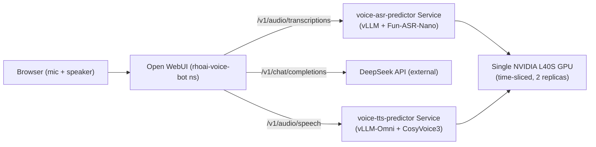

# rhoai-voice-bot v0: Fun-ASR-Nano (vLLM) -> DeepSeek -> CosyVoice3 (vLLM-Omni)

**Created:** 2026-11-02 · **Last updated:** 2026-11-02

**Based on:** OpenShift 4.22 (sandbox), RHOAI 3.5.2, KServe v1beta1/v1alpha1
(RawDeployment mode), `vllm/vllm-openai:v0.27.1` (ASR), `vllm/vllm-omni:v0.32.0`
(TTS), `ghcr.io/open-webui/open-webui:main`. NVIDIA GPU Operator with
time-slicing (device-plugin config), NVIDIA L40S (46 GiB VRAM).

## Overview

This is the first working iteration of the Qwen-family voice bot from
[docs/PRD-QWEN-VOICE-BOT.md](../../docs/PRD-QWEN-VOICE-BOT.md), deliberately
simplified: no custom code, no container builds. All three model-facing
components are published images; the only deliverable is OpenShift YAML
plus a Makefile.

| Component | Image | Model | Endpoint |
|---|---|---|---|
| ASR | `vllm/vllm-openai:v0.27.1` | `FunAudioLLM/Fun-ASR-Nano-2512-vllm` | `POST /v1/audio/transcriptions` |
| LLM | external | DeepSeek `deepseek-chat` | `POST /v1/chat/completions` |
| TTS | `vllm/vllm-omni:v0.32.0` | `FunAudioLLM/Fun-CosyVoice3-0.5B-2512` | `POST /v1/audio/speech` |
| UI | `ghcr.io/open-webui/open-webui:main` | n/a | browser Voice Mode |

## Architecture



ASR and TTS are both KServe `InferenceService` + custom `ServingRuntime`
pairs (not `LLMInferenceService`/llm-d -- no router/scheduler needed for
single-replica internal services). They are deliberately **not** given
`networking.kserve.io/visibility: exposed` -- see Troubleshooting. Open
WebUI reaches them via in-cluster Service DNS only.

## Prerequisites

- `oc` CLI logged in with cluster-admin (or equivalent) access
- A valid DeepSeek API key (`https://platform.deepseek.com/api_keys`) --
  **do not assume a key from another install (e.g. `openshift-lightspeed`)
  is still valid; test it independently first** (see Troubleshooting)
- At least one GPU node (`nvidia.com/gpu.present=true`) with no other
  GPU-requesting pods on it. If the cluster has a GPU you cannot free, see
  "GPU sharing" below -- it is designed around exactly that constraint.

## Deploy

```bash
cd app/rhoai-voice-bot
cp .env.example .env   # fill in DEEPSEEK_API_KEY
make deploy            # namespace, GPU sharing, secret, asr, tts, open-webui
make register-voice VOICE_WAV=/path/to/ref.wav VOICE_TEXT="exact transcript of ref.wav"
make status
make webui-url
```

`register-voice` is a required manual step -- see "CosyVoice3 has no
preset voices" below. A quick way to generate a reference clip on macOS:

```bash
say -o /tmp/ref.aiff "Any short sentence works as a voice reference."
afconvert -f WAVE -d LEI16@16000 -c 1 /tmp/ref.aiff /tmp/ref.wav
```

## GPU Sharing (time-slicing)

This cluster had only **one free GPU** across two GPU-worker nodes (the
other already ran an unrelated workload). ASR and TTS each normally want
a dedicated GPU. `make enable-gpu-sharing` (part of `make deploy`):

1. Applies [openshift/gpu-time-slicing-cm.yaml](../../openshift/gpu-time-slicing-cm.yaml)
   -- a named NVIDIA device-plugin time-slicing profile (`replicas: 2`)
2. Patches `clusterpolicy/gpu-cluster-policy` to reference it by name
   (`spec.devicePlugin.config.name`) -- this alone changes nothing for any
   node, since no per-node label points at it yet
3. Auto-detects the first GPU node with **zero** GPU-requesting pods and
   labels *only that node* `nvidia.com/device-plugin.config=voice-bot`

Nodes without that label (e.g. a GPU node already running something else)
are completely unaffected -- verified via `oc get node <other-node> -o
jsonpath='{.status.allocatable.nvidia\.com/gpu}'` staying at `1` throughout.
The labeled node's allocatable count becomes `2`.

**Time-slicing shares GPU compute scheduling only, not VRAM isolation.**
Both `--gpu-memory-utilization` values (ASR 0.40, TTS 0.30) were chosen
conservatively so combined usage stays well under the physical GPU's
VRAM (confirmed via `nvidia-smi` inside a pod: ~35 GiB used of 46 GiB on
an L40S, with both services running).

## Troubleshooting and Fixes

Every issue hit during the actual deployment of this stack, in the order
encountered. If you hit the same symptom, apply the same fix.

### 1. `PermissionError: [Errno 13] Permission denied: '/.cache'` (ASR crash loop)

**Symptom:** `kserve-container` crash-loops immediately after model
weights download; log shows `flashinfer` import failing with
`PermissionError: [Errno 13] Permission denied: '/.cache'`.

**Cause:** OpenShift runs containers as a random non-root UID with no
`/etc/passwd` entry, so `$HOME` resolves to `/` by default. vLLM's
`flashinfer` dependency tries to create `$HOME/.cache` at import time and
fails because `/` isn't writable by that UID.

**Fix:** set `HOME=/tmp` explicitly in the container env (see
[openshift/asr-sr.yaml](../../openshift/asr-sr.yaml) and
[openshift/tts-sr.yaml](../../openshift/tts-sr.yaml)).

### 2. `ImportError('Please install vllm[audio] for audio support')` (ASR 400s)

**Symptom:** ASR pod is `Ready`, but every `/v1/audio/transcriptions`
request returns `400 {"error":{"message":"Invalid or unsupported audio
file."...}}`. Server logs show `Failed to load audio via soundfile:
ImportError('Please install vllm[audio] for audio support')`.

**Cause:** the published `vllm/vllm-openai:v0.27.1` image does not bundle
the `vllm[audio]` extras (librosa/soundfile) needed to decode uploaded
audio.

**Fix:** override the container `command`/`args` to `pip install
--no-cache-dir 'vllm[audio]'` before `exec vllm serve ...` (still the
unmodified published image -- no custom build). See
[openshift/asr-sr.yaml](../../openshift/asr-sr.yaml). Also remember to pass an
explicit MIME type when testing with curl: `-F "file=@sample.mp3;type=audio/mpeg"`
(omitting it can also trigger the generic "Invalid or unsupported audio
file" error even once the extras are installed).

### 3. CosyVoice3 requires `--trust-remote-code`

**Symptom:** without it, the official `vllm serve
FunAudioLLM/Fun-CosyVoice3-0.5B-2512 --omni` command fails to load the
model (custom modeling code).

**Fix:** always include `--trust-remote-code` in the TTS ServingRuntime
args.

### 4. CosyVoice3 has no preset voices -- `ref_audio` / voice registration required

**Symptom:** `POST /v1/audio/speech` with any `voice` name (even ones
listed by `GET /v1/audio/voices`, e.g. `"default"`) returns `400
{"error":{"message":"CosyVoice3 requires 'ref_audio' ..."}}`.

**Cause:** CosyVoice3 is voice-cloning-only. `GET /v1/audio/voices`
always lists configured voice *names* (from `AUDIO_TTS_VOICE` etc.) but
they are not usable until a reference audio sample is uploaded for that
name.

**Fix:** register a voice before use:

```bash
curl -X POST http://<tts-host>/v1/audio/voices \
  -F "audio_sample=@ref.wav" \
  -F "consent=<any-id>" \
  -F "name=default" \
  -F "ref_text=exact transcript of ref.wav"
```

(`make register-voice VOICE_WAV=... VOICE_TEXT=...` wraps this.) Note the
correct endpoint is `/v1/audio/voices` (vllm-omni's actual API) -- **not**
`/v1/voices/register`, which is a different, unrelated community TTS
project's endpoint convention; don't confuse the two when reading
third-party docs/images for this model family.

### 5. Registered voice disappears after every pod restart

**Symptom:** voice registration succeeds and TTS works, but after any pod
restart, `GET /v1/audio/voices` shows the name again but `uploaded_voices`
is empty and speech generation fails with the `ref_audio` error again.

**Cause (two layers, both hit in this deployment):**

1. First attempt mounted the voice-cache PVC at `/root/.cache/vllm-omni`,
   but the container's `$HOME` was set to `/tmp` (fix #1 above) -- so
   vllm-omni actually read/wrote `/tmp/.cache/vllm-omni/speakers`, never
   touching the PVC at all. Voices "registered" fine but lived only in
   the ephemeral container filesystem.
2. After correcting the mount path to `/tmp/.cache/vllm-omni` directly,
   the pod crash-looped with a **new** set of permission errors:
   `PermissionError: [Errno 13] Permission denied: '/tmp/.cache/vllm'`
   and `'/tmp/.cache/flashinfer'`. Mounting a PVC *inside* `/tmp/.cache`
   makes kubelet auto-create the parent directory `/tmp/.cache` itself as
   a plain directory owned `root:root` with no group-write bit -- which
   then blocks the container's own (unrelated) sibling cache dirs
   (`vllm`'s and `flashinfer`'s own caches) from being created by the
   non-root UID. Confirmed via `oc exec ... -- ls -ld /tmp/.cache
   /tmp/.cache/vllm-omni`: the PVC mount itself was `drwxrws... root
   1000960000` (group-writable, fine), but its kubelet-created parent was
   `drwxr-xr-t root root` (not writable by the pod's supplementary GID).

**Fix:** mount the PVC at a **standalone path outside `/tmp/.cache`**
(e.g. `/voice-cache`), and in the container's startup command, create
`$HOME/.cache` normally (the container's own process owns it fine, same
as it already does for ASR) and symlink the real target into place:

```sh
mkdir -p "$HOME/.cache" && ln -sfn /voice-cache "$HOME/.cache/vllm-omni" && exec vllm serve ...
```

See [openshift/tts-sr.yaml](../../openshift/tts-sr.yaml) and
[openshift/tts-isvc.yaml](../../openshift/tts-isvc.yaml) (PVC `voice-tts-cache`).
Verified by deleting the pod and confirming `GET /v1/audio/voices` still
shows `uploaded_voices` populated, and a speech request with that voice
succeeds, after restart.

### 6. KServe auto-creates an unauthenticated external Route

**Symptom:** after applying `asr-isvc.yaml`/`tts-isvc.yaml` with
`networking.kserve.io/visibility: exposed` (copied from an existing
cluster example), `oc get route -n rhoai-voice-bot` shows `voice-asr` and
`voice-tts` Routes with public hostnames -- fully reachable from the
internet, with **no authentication** (vLLM's OpenAI server has no
`--api-key` set here).

**Fix:** remove the `exposed` visibility label from both InferenceServices.
Open WebUI reaches them via the in-cluster Service DNS name
(`voice-asr-predictor.rhoai-voice-bot.svc.cluster.local`,
`voice-tts-predictor...`) -- no Route is needed for them at all. Re-apply
and confirm with `oc get route -n rhoai-voice-bot`: only `open-webui`
should be listed.

### 7. TLS handshake timeout on `oc apply` (transient)

**Symptom:** `oc apply -f ...` occasionally fails with `net/http: TLS
handshake timeout` against the cluster API.

**Fix:** transient; just retry the same command. (Matches a known
behavior already documented for this same cluster in
[.cursor/skills/openshift-lightspeed-deepseek/SKILL.md](../../../../.cursor/skills/openshift-lightspeed-deepseek/SKILL.md).)

### 8. DeepSeek key reused from another install was invalid

**Symptom:** Open WebUI's model dropdown shows "No models available /
Connect to an AI provider to start chatting"; pod logs show `Unexpected
error: External Error: {'message': 'Authentication Fails, Your api key:
****XXXX is invalid'...}`.

**Cause:** reused a `DEEPSEEK_API_KEY` from an existing
`openshift-lightspeed` installation on the same cluster, assuming it was
still valid. It returned `401` even when tested directly against
`https://api.deepseek.com/chat/completions` with `curl` -- independent of
Open WebUI, confirming the key itself (not the integration) was the
problem.

**Fix:** always validate a DeepSeek key directly before wiring it in:

```bash
curl -s -o /dev/null -w "%{http_code}\n" https://api.deepseek.com/chat/completions \
  -H "Content-Type: application/json" -H "Authorization: Bearer $DEEPSEEK_API_KEY" \
  -d '{"model":"deepseek-chat","messages":[{"role":"user","content":"hi"}]}'
# 200 = good, 401 = bad key
```

### 9. Open WebUI ignores a *new* API key after updating the Secret + restart

**Symptom:** after fixing #8 (new valid key in the Secret, pod restarted),
Open WebUI logs **still** show the exact same masked old key suffix
(e.g. `****FUbS`) in the authentication-failure error -- as if the Secret
update never took effect, even though `oc get secret` confirms the new
value and the pod restarted cleanly.

**Cause:** by default Open WebUI persists `OPENAI_API_KEYS`/connections
config into its SQLite DB (on the `open-webui-data` PVC) on first boot,
and silently ignores env var changes on every subsequent boot unless told
not to. This matches a gotcha already encoded in
`third_party/openshift-ai-bootstrap/Makefile`'s plain Open WebUI install,
which runs `oc set env deploy/open-webui ENABLE_PERSISTENT_CONFIG=False`
for exactly this reason.

**Fix:** set `ENABLE_PERSISTENT_CONFIG: 'False'` in the Open WebUI
ConfigMap (see [openshift/open-webui.yaml](../../openshift/open-webui.yaml)),
then restart. Verified: after this, updating the Secret and restarting
the pod picked up the new key immediately and the chat model appeared.

## Verification

```bash
make test-asr    # transcribes the official Fun-ASR-Nano sample, expects
                  # the exact text: 开饭时间早上九点至下午五点。
make test-tts VOICE_NAME=default   # expects HTTP 200 + a valid WAV file
make webui-url    # open in a browser, log in, enable Voice Mode, talk
```

End-to-end confirmed working: a live voice conversation through the
browser produced, in order, `POST /v1/audio/transcriptions` (200) on the
ASR service, `POST /api/chat/completions` (200) through Open WebUI to
DeepSeek, and `POST /v1/audio/speech` (200) on the TTS service, with
audio played back and the mic re-arming for the next turn.

## Known Limitations (v0)

- No HF model-weight caching across pod restarts (no PVC for `HF_HOME`) --
  every restart redownloads ASR (~4 GB) and TTS (~1 GB-ish core weights,
  plus ONNX/pt assets) from HuggingFace, taking a few minutes.
- No orchestrator -- Open WebUI drives STT -> Chat -> TTS directly; no
  session management, barge-in handling, or retry/failover logic from the
  full PRD design.
- GPU time-slicing is cluster-wide infrastructure (`ClusterPolicy` patch +
  ConfigMap); `make undeploy` intentionally leaves it in place (harmless
  when unused) and prints the manual revert commands.
- DeepSeek key was pasted directly into chat during setup in this
  instance -- prefer `.env` or a secret manager for any real deployment.
